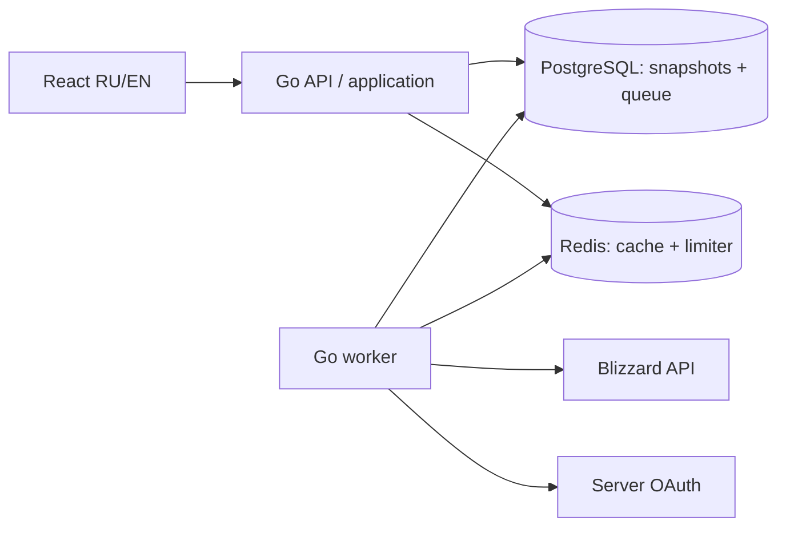

# Спецификация MVP v0.1

30 октября 2026 года. Основание: [принятая архитектура v1.0](../architecture/v1.0.md), [ADR-0001](../decisions/0001-architecture-baseline.md).

Статус: исходная спецификация этапа 1. Текущее состояние реализации и фактические проверки описаны в [отчёте](../operations/implementation-validation.md). Числа, обозначенные как стартовые настройки, можно менять конфигурацией после измерений; это не обещания производительности и не ограничения Blizzard.

## 1. Проверяемый результат

Посетитель выбирает EU или US, сервер и имя персонажа, открывает публичный профиль и видит экипировку, характеристики и выбранные таланты. Каждый раздел показывает источник, время загрузки и полноту. При первом обращении браузер отслеживает фоновое задание; при устаревшем, но допустимом снимке показывает возраст данных и состояние обновления.

MVP должен запускаться локально через Docker Compose с API, worker, PostgreSQL, Redis и web. Серверный Blizzard Client Secret никогда не передаётся браузеру. Для разработки без ключей допустим отдельный явно обозначенный fixture-режим; переключение в него при ошибке production-провайдера запрещено.

## 2. Границы этапа

| Входит в MVP | Следующие этапы |
| --- | --- |
| Каталог серверов EU/US, поиск точного персонажа | Массовый поиск игроков и гильдий |
| Blizzard OAuth Client Credentials на сервере | Пользовательская авторизация и административный интерфейс |
| Профиль, экипировка, характеристики, активные таланты | Mythic+, рейды, Warcraft Logs, гильдии, сравнение |
| Фоновые обновления, лимиты, повторы, удаление | Симуляции, BiS, ротация, боевые рекомендации |
| RU/EN, адаптивность, клавиатурная навигация | Полноценный редактор дерева талантов |
| Показ полноты и достоверности данных | Исполнение проверенных игровых rulesets — этап 2 |

Первые правила уже специфицированы в [analysis-rules.md](analysis-rules.md), но их наличие в документе не включает непроверенные рекомендации в этап 1. До подтверждения правил UI показывает данные без оценки. Полный первоначальный список таблиц и API остаётся ориентиром следующих этапов; пустые таблицы и endpoints будущих модулей в MVP не создаём.

## 3. Компоненты и зависимости

Domain не импортирует Chi, pgx, Redis или провайдерские DTO. Application определяет порты хранилища, очереди и кеша. Infrastructure реализует их. Transport валидирует запрос и переводит типизированный результат в REST DTO. Composition roots — `cmd/api` и `cmd/worker`; названия каталогов описывают будущую реализацию.

PostgreSQL обеспечивает достоверность снимка, права на публикацию, единственность активной задачи и смену текущего снимка. Redis ускоряет чтение и распределяет лимиты; отказ Redis не отменяет проверку допустимости выдачи. При невозможности безопасно проверить публикацию в PostgreSQL API отвечает 503. Отказ провайдера сам по себе не делает внутреннюю readiness-проверку ошибочной, если приложение способно безопасно отдавать кеш и принимать задания.

## 4. Идентичность и модели

Ключ запроса: `region + canonical realm + normalized character name`. Регион входит во все ключи БД, очереди и кеша. Сервер выбирается из каталога Blizzard по региону; отображаемое русское название не подменяет канонический slug. Неоднозначное название требует выбора конкретного сервера.

Имя нормализуется в Unicode NFC с Unicode case folding и повторным NFC; сохраняется исходное отображаемое имя. Это алгоритм приложения, версионируемый при смене библиотеки, а не SQL `lower()`. Транслитерация, удаление диакритики и замена похожих букв запрещены. Длина и допустимые символы определены в [REST-контракте](api-contract.md); кириллица поддерживается.

Внутренний UUID не равен Blizzard ID. Совпадающие имена в разных регионах и на разных серверах — разные записи. Переносы и переименования не склеиваем эвристически. Если Blizzard ID под тем же поисковым ключом изменился, старые снимки удаляются, старая внутренняя идентичность не переносится новому персонажу; точный переход описан в [data-model.md](data-model.md).

| Модель | Смысл |
| --- | --- |
| Character | Внутренняя идентичность и указатель на текущий снимок |
| Realm | Регион, Blizzard ID, канонический slug, локализованные имена |
| Snapshot | Неизменяемый результат конкретного сбора, источник и версия нормализации |
| Section | profile / equipment / statistics / talents, состояние complete / partial / unavailable и собственные timestamps |
| EquipmentItem | Слот, предмет, уровень, доступные зачарования/камни/комплект без домыслов |
| TalentLoadout | Специализация, доступные узлы и экспортная строка, если её предоставил источник |
| RefreshJob | Долговременная задача с retry, lease и fencing token |

Нормализованные числовые идентификаторы источника в JSON передаются десятичными строками, чтобы браузер не терял точность. Неизвестное значение — `null` или явная недоступность, не `0`, пустой билд или пустая экипировка. `patch`, `season` и игровой build не выводим из календарной даты: неизвестный контекст остаётся `null`.

## 5. Поток чтения и обновления

1. API проверяет параметры и разрешает realm через локальный каталог. Вызова Blizzard из HTTP handler нет.
2. Проверяет состояние публикации и срок действия данных в PostgreSQL. Затем может читать соответствующую версию снимка из Redis.
3. Готовые свежие данные — 200 `fresh`. Допустимые устаревшие — 200 `stale` и единственное задание на обновление.
4. Если пригодного обязательного профиля нет, создание или присоединение к задаче даёт 202 `pending`, `Location` и `Retry-After`. После окончательного сбоя следующий GET не создаёт бесконечную цепочку задач: действует retry cooldown и безопасная 502/503.
5. Worker получает lease в короткой транзакции `FOR UPDATE SKIP LOCKED`, освобождает транзакцию до сетевых запросов, проверяет общий лимит и загружает обязательный профиль.
6. После пригодного профиля получает equipment/statistics/talents. Ошибка необязательной секции не превращается в удаление персонажа. Старые допустимые секции можно перенести, сохраняя исходный возраст; не относящиеся к новой специализации таланты не переносятся как активные.
7. В одной транзакции с проверкой fencing token и срока lease записывает новый снимок, переключает указатель и завершает задачу. Параллельное удаление или новый владелец lease запрещают устаревшему worker коммит.
8. Сброс/перезаполнение кеша происходит после commit. Кеш содержит UUID/версию снимка и timestamps; удалённый или заменённый снимок не может быть опубликован через старый кеш.

Терминальные состояния `succeeded`, `failed`, `cancelled`; активные — `queued`, `running`, `retry_wait`. Отсутствие талантов после успешного profile — конечный честный ответ, а не бесконечная загрузка. Для unavailable-секций автоматический GET-refresh не повторяется раньше `checked_at + TTL` соответствующей секции; новый GET не обходит частоту обновления только из-за отсутствующего payload. Детальный REST и polling описаны в [api-contract.md](api-contract.md).

## 6. Возраст, недоступность и очистка

| Данные | Стартовая свежесть | Предельная допустимость |
| --- | --- | --- |
| Профиль, экипировка, характеристики | 15 минут на секцию | Не позже собственного `valid_until` и срока профиля |
| Таланты | 30 минут | Не позже собственного `valid_until` и срока профиля |
| Каталог серверов | 24 часа; обновление планировщиком | Проектная политика обновления и удаления по возрасту |
| Негативный результат summary 404 | 5 минут в кеше | Без старого профиля; только краткоживущий ключ отсутствия |

Проектная консервативная политика для данных Blizzard — не хранить и не отображать их дольше 30 дней без нового получения соответствующих данных; успешная проверка profile не обновляет возраст старой equipment. Плановая перепроверка начинается до истечения срока, например на 27-й день. Сканер очистки работает ежечасно, но фильтр чтения скрывает истёкшее немедленно. Это внутренняя политика проектирования; актуальные условия провайдера нужно сверить до публичного запуска, см. [sources.md](sources.md).

Подтверждённый 404 обязательного summary при корректном сервере, namespace и авторизации прекращает публикацию и инициирует каскадное удаление профиля, снимков, задач, нормализованных разделов, кеша и производных результатов. 404 необязательной секции значит недоступность секции. Неоднозначный 403 summary изолирует профиль от выдачи, возвращает безопасную ошибку поставщика и требует серверной перепроверки; он не доказывает удаление. 401 допускает однократное обновление серверного токена, затем означает ошибку авторизации поставщика.

Очистка охватывает все копии и производные данные, включая технические задачи с ключом персонажа. Обезличенные агрегаты не должны позволять восстановить профиль. Логи не содержат полные ответы, имя персонажа в URL или секреты; вместо raw path логируется route template. До запуска должны быть описаны срок хранения резервных копий, журнал удалений для восстановления и повторная очистка до открытия восстановленной базы для чтения.

## 7. Стартовые эксплуатационные настройки

Настройки являются предложением для первого окружения, а не одобренным бюджетом или измеренными лимитами провайдера.

| Параметр | Начальное значение |
| --- | --- |
| Регионы / UI | EU, US / ru-RU, en-US |
| API read limiter | 120 запросов/мин на IP, burst 20 |
| Refresh limiter | 3 запроса/мин на IP, burst 1; cooldown персонажа 60 секунд |
| Polling UI | От 3 до 15 секунд с backoff; после 2 минут остановить автопросмотр, сохранить job ID |
| Конкурентность worker | 4; общий бюджет исходящих запросов на приложение, а не на реплику |
| Стартовый исходящий лимит | 2 запроса/с суммарно, burst 2; далее настройка по подтверждённым квотам |
| HTTP timeout провайдера | 10 секунд на запрос, общий deadline сбора 120 секунд |
| Lease / heartbeat | 60 / 15 секунд; потеря продления запрещает commit |
| Попытки | Не более 5 фактических попыток; exponential backoff + jitter, локальная база 2 секунды, локальный cap 5 минут |
| Retry-After | Приоритет перед локальным backoff; не сокращать до локального cap |
| Повтор после terminal failure | Не раньше чем через 15 минут или более поздний provider Retry-After |
| Максимальная очередь | 10 000 активных задач; при переполнении 503, без ложного 202 |

При отказе Redis API применяет консервативный локальный limiter с учётом числа реплик либо закрывает дорогие операции; worker использует общий PostgreSQL provider budget. Отказ distributed limiter не открывает неограниченный доступ к Blizzard. Счётчик попыток не расходуется лишь из-за ожидания лимитера до фактического провайдерского запроса.

Server budget, production host и число реплик остаются открытыми. До их определения не фиксируем SLO как гарантии. Указанные в архитектуре p95, 1000 RPS и 99,9% — цели для последующих измерений.

## 8. Интерфейс

Главная: регион, выбор сервера с поиском по локализованному имени, имя и кнопка поиска. Формат URL сохраняет регион/канонический сервер/имя; язык UI хранится отдельно.

Профиль: имя, сервер/регион, класс, специализация и доступные базовые сведения; вкладки обзор, экипировка, характеристики, таланты. В каждой вкладке видны возраст данных, недоступные поля и состояние обновления. Таланты в MVP можно показать списком узлов и доступной строкой экспорта, без имитации полного интерактивного дерева.

Состояния: initial, validating, pending, fresh, stale/updating, partial, not found/unavailable, rate limited, provider error, terminal job failure. Пока выполняется задача, кнопка не создаёт дубликаты. При terminal job failure polling завершается, остаются пригодные данные и понятная возможность повторить позже. 404 и карантин скрывают старый профиль.

Тёмная фэнтези-палитра, цвета классов и редкости дополняются текстом. Доступны фокус с клавиатуры, подписи полей, сообщение об ошибке рядом с полем, `aria-live` для статуса обновления. Проверяем ширину 360 px и desktop; отсутствие горизонтального скролла у основного содержимого. Переключение RU/EN не меняет идентичность или задачу загрузки.

## 9. Порядок реализации и готовность

| Пакет | Результат | Проверка завершения |
| --- | --- | --- |
| A. Foundation | Go module, Chi, конфигурация, migrations, Compose, CI | Сборка API/worker/web, безопасные health checks, чистая миграция и откат |
| B. Storage + queue | Репозитории, кеш, lease, GC, лимитеры | Реальные PostgreSQL/Redis integration tests, crash/reclaim/dedup/purge |
| C. Blizzard | OAuth, realm catalog, нормализация секций | Redacted provider fixtures, 401/403/404/429/timeout contracts |
| D. Application + REST | Read/refresh/jobs endpoints из OpenAPI | Валидация запросов, response schemas, fresh/stale/pending/partial |
| E. React | RU/EN поиск и профиль | Browser E2E и проверка доступности/адаптивности |
| F. Release candidate | Наблюдаемость, очистка, runbook | [Приёмочная матрица](acceptance-tests.md), измерения, проверка секретов |

В этап 1 входят структурированные логи, request ID, базовые Prometheus-метрики HTTP/очереди/провайдера/возраста, liveness/readiness и корректное завершение процессов. Полный набор Grafana/OTel, нагрузочная и security-приёмка публичного сервиса расширяется на этапе 6 исходного плана; отсутствие базовой наблюдаемости в MVP этим не оправдывается.

MVP готов, когда один сценарий «поиск → задача → профиль → обновление» работает от браузера до реального Blizzard, обязательные негативные сценарии проходят, а сервис корректно стартует с чистой БД через Compose. Успешная проверка самих спецификаций не подтверждает этот результат.

До проверки реальной интеграции понадобятся серверные Blizzard credentials и актуальные обезличенные примеры ответов EU/US. До публичного запуска — эксплуатационный бюджет/хостинг, проверка условий источников, политика данных/резервных копий и нагрузочная приёмка. Источники эталонных билдов требуются для этапа 2 и не блокируют просмотр профиля этапа 1.
